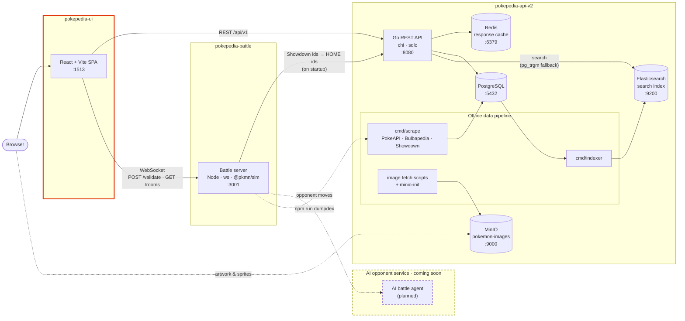

# PokePedia (Web UI)
Dive into the ultimate Pokémon encyclopedia! PokePedia is your one-stop resource for everything you need to know about
the iconic Pokémon universe. Whether you're a casual trainer or a seasoned Pokémon Master, PokePedia has it all
— from detailed profiles of all 1025 Pokémon and their 1,290+ forms, to in-depth information on 830+ moves,
310+ abilities and 1,800+ items.

With the most up-to-date data from *Pokémon Scarlet and Violet* and *Pokémon Legends: Z-A*, plus every previous title,
PokePedia is here to guide you through every aspect of the Pokémon world. Build a team, check its weaknesses, then take it
into a real Showdown-powered battle against a friend. Your adventure starts here!

## Technologies 💻
- React 18 + TypeScript (Base)
- Vite (Build tool / dev server)
- Material-UI 6 + Emotion (Styling)
- TanStack Query (Data fetching and caching)
- Zustand (State Management)
- React Router (Routing)
- dnd-kit (drag and drop toolkit)
- Used in tandem with:
  - [PokePedia API](https://github.com/Rishi2804/pokepedia-api-v2) — Go REST API for all Pokémon data and search
  - [PokePedia Battle Service](https://github.com/Rishi2804/pokepedia-battle-service) — WebSocket battle server built on Pokémon Showdown

## System Design 🏗️
PokePedia is split into three services. This repo is the web UI (highlighted).



- **Pokémon data** (Pokédex, moves, abilities, items, search, team-building candidates) comes from the Go API.
- **Images** (HOME/official artwork, item icons, Showdown battle sprites) load straight from the MinIO image store.
- **Battles and team validation** go to the battle server, which runs the Pokémon Showdown engine server-side.
- **Teams** are saved in your browser (`localStorage`), so no account is needed.

## Features
Below we have snapshots into all the features this website offers with visuals. Screenshots follow your GitHub theme (light or dark).

### Pokédex
Each game has a different Pokédex (list of species available in the base game), so naturally
the first thing to do would be to select a game first. \
The top option is HOME, a list of all Pokémon that have ever been introduced. Every game from *Red and Blue* through *Legends: Z-A* is here.

<picture>
  <source media="(prefers-color-scheme: dark)" srcset="https://github.com/user-attachments/assets/f18e0023-bccd-4317-aa74-969872aa5cdf">
  
</picture>

We are then lead to a list of all the relevant Pokémon and its forms that appear in the selected game, grouped by regional dex.
From here you can search, or filter by type for a Pokémon as you desire

<picture>
  <source media="(prefers-color-scheme: dark)" srcset="https://github.com/user-attachments/assets/7d3bd7c9-7d85-4aaf-8c80-83bca28d9bdf">
  
</picture>

Clicking on a specific Pokémon allows you to have a better look at the species, with a tab for each of its forms (Megas, Gigantamax, regional variants...) and information including:
- Biometrics
- Stats (Attack, Defense, Speed, etc)
- Type Relations (Weaknesses and Strengths)
- Abilities
- Evolutions
- Pokédex Entries (Descriptions)
- Learnsets (Learnable moves by level up, TM, tutor and egg)
- Images (HOME and official artwork, including shiny and female variants)

<picture>
  <source media="(prefers-color-scheme: dark)" srcset="https://github.com/user-attachments/assets/ecaf4cda-1667-4c28-9a73-8e3ba15ec1b3">
  
</picture>

### Moves
All moves are listed by generation with the ability to search and filter by type as desired

<picture>
  <source media="(prefers-color-scheme: dark)" srcset="https://github.com/user-attachments/assets/66a32ed2-9465-430c-8f61-e9c5352f5e83">
  
</picture>

Once a specific move is clicked, you can see more details about it including:
- Basic Info (Type, Class, Power, Accuracy, etc)
- Effect (What the move does) and Z-Move effects
- History (how its power, accuracy and PP changed across games)
- Descriptions
- List of Pokémon that can learn the move, by level up, TM, tutor or egg

<picture>
  <source media="(prefers-color-scheme: dark)" srcset="https://github.com/user-attachments/assets/439cb92e-e232-4433-aabc-c3f6a7ca4e53">
  
</picture>

### Abilities
Similar to Moves, all abilities are listed by generation in a similar fashion as well as the ability to search. Clicking on an ability shows its effect, descriptions and every Pokémon that can have it

<picture>
  <source media="(prefers-color-scheme: dark)" srcset="https://github.com/user-attachments/assets/aeffb5fd-1e7c-4a44-b1af-dc53f72af0e5">
  
</picture>
<picture>
  <source media="(prefers-color-scheme: dark)" srcset="https://github.com/user-attachments/assets/7ef0bcea-4067-4639-8edf-634d8a4375c9">
  
</picture>

### Items
Every item in the series, from Poké Balls and medicine to battle items and berries, grouped by bag pocket with a search bar

<picture>
  <source media="(prefers-color-scheme: dark)" srcset="https://github.com/user-attachments/assets/19549e85-00c5-497f-b51c-bfd403b36b1f">
  
</picture>

Clicking on an item shows its effect, details (category, generation, price, Fling power), which battle formats it is legal in, its descriptions and which wild Pokémon hold it

<picture>
  <source media="(prefers-color-scheme: dark)" srcset="https://github.com/user-attachments/assets/249247b4-c486-4fb9-a62f-e27a51bf4de5">
  
</picture>

### Types
The Pokémon Type Chart can be very complex! This page makes it easier to view how a type combo matches up with the rest of the 18 Pokémon types

<picture>
  <source media="(prefers-color-scheme: dark)" srcset="https://github.com/user-attachments/assets/b340effe-3c6b-444b-89e8-60900b690142">
  
</picture>

### Search
The search bar in the header suggests Pokémon, moves, abilities and items as you type, and is forgiving of typos

<picture>
  <source media="(prefers-color-scheme: dark)" srcset="https://github.com/user-attachments/assets/2557f9c9-c703-4495-bf41-748978ba2a1a">
  
</picture>

Pressing enter brings up the full results page, grouped by category

<picture>
  <source media="(prefers-color-scheme: dark)" srcset="https://github.com/user-attachments/assets/b9e01cd0-3898-445f-9f21-00f3f08a8ca5">
  
</picture>

### Team Builder
In the games, you are allowed to only keep a team of 6 Pokémon on you at all times. Building a balanced team with minimal
and uniformly distributed weaknesses can be challenging. This feature aids you in that, allowing you to pick from a list of Pokémon available in the chosen game.
User teams save to browser storage and show on the landing page, where they can be dragged to reorder.

<picture>
  <source media="(prefers-color-scheme: dark)" srcset="https://github.com/user-attachments/assets/25b419ea-3c24-46bf-bb61-1aee59cb2977">
  
</picture>

Once you select the game you want to build a team for, clicking on any Pokémon adds it to your team. \
Teams can also be imported from (and exported to) Pokémon Showdown's text format.

<picture>
  <source media="(prefers-color-scheme: dark)" srcset="https://github.com/user-attachments/assets/fe2c3ad3-9d15-4222-847e-15dba425a3de">
  
</picture>

Clicking a team member opens a Showdown-style set editor. The options follow the rules of the chosen game, so you only see what that game supports:
- Moves, ability, held item and nature
- EVs and IVs (or Stat Experience and DVs for Gen 1–2), with live stat totals
- Level, gender, shiny, happiness and Poké Ball
- Tera Type, Dynamax level and Gigantamax

<picture>
  <source media="(prefers-color-scheme: dark)" srcset="https://github.com/user-attachments/assets/65649671-4299-4723-978d-7d03f8f20d1a">
  
</picture>

"Show Analysis" breaks down the team's defensive and offensive type coverage, and a validation panel checks the team
against the battle server's Showdown rules as you edit, so you know it is legal before you battle with it.

<picture>
  <source media="(prefers-color-scheme: dark)" srcset="https://github.com/user-attachments/assets/8e7bb506-49d8-4ad6-8f0c-e14305e4829e">
  
</picture>

### Battle
Take your team into a real battle! Battles are run by the Pokémon Showdown engine on the [battle server](https://github.com/Rishi2804/pokepedia-battle-service),
using the right rules for the game your team was built for (Gen 1 through Gen 9, National Dex for HOME teams, and Legends: Z-A). \
Create a room with one of your saved teams (or paste a Showdown team), then share the 6-character room code with a friend so they can join.

<picture>
  <source media="(prefers-color-scheme: dark)" srcset="https://github.com/user-attachments/assets/e0b1835d-2fa7-46e5-a47c-bc0a3a135d05">
  
</picture>

Once both players are in, drag your Pokémon into your lead order during Team Preview

<picture>
  <source media="(prefers-color-scheme: dark)" srcset="https://github.com/user-attachments/assets/856d91a6-b2bf-41cb-a3ab-27996331930c">
  
</picture>

Then battle it out! The battle screen shows animated sprites, HP and status, field effects and a battle log you can speed up.
Pick moves (with Terastallize, Mega Evolve, Z-Moves and Dynamax where the game allows it) or switch. If you lose connection,
reloading the page puts you back in the battle.

<picture>
  <source media="(prefers-color-scheme: dark)" srcset="https://github.com/user-attachments/assets/0dd93dcc-231f-4f51-b2b3-b334891bb922">
  
</picture>

> 🤖 **Coming soon:** an AI opponent, so you can battle without a friend.

## Getting Started 🚀
### Prerequisites
- Node.js 20+
- The [PokePedia API](https://github.com/Rishi2804/pokepedia-api-v2) running (it also hosts the image store)
- The [PokePedia Battle Service](https://github.com/Rishi2804/pokepedia-battle-service) running (only needed for battles and team validation)

### Environment
Create a `.env` file in the project root:

| Variable | Description | Local default |
|---|---|---|
| `VITE_POKEMON_API` | Base URL of the Go API | `http://localhost:8080/api/v1` |
| `VITE_POKEMON_IMAGES_URL` | Base URL of the MinIO image bucket | `http://localhost:9000/pokemon-images` |
| `VITE_BATTLE_WS_URL` | Battle server WebSocket URL (HTTP calls use the same host) | `ws://localhost:3001` |

### Run it
```bash
npm install
npm run dev        # http://localhost:1513
```

Or with Docker:
```bash
docker compose up -d
```

Other scripts: `npm run build` (type-check and production build), `npm run lint`, `npm run preview`.

### Running the whole stack
Clone the three repos side by side, then start them in order:

```
PokePedia/
├── pokepedia-api-v2/
├── pokepedia-battle/      (pokepedia-battle-service repo)
└── pokepedia-ui/
```

```bash
(cd pokepedia-api-v2 && docker compose up -d)   # Postgres, Redis, Elasticsearch, MinIO, API — see its README for migrations and indexing
(cd pokepedia-battle && docker compose up -d)   # battle server on :3001
(cd pokepedia-ui && docker compose up -d)       # UI on :1513
```

## Project Structure 📁
```
src/
├── pages/            # One folder per feature: Pokedex, Pokemon, Moves, Abilities, Items, Types, Search, TeamBuilder, Battle
├── components/       # Shared UI: cards, lists, filters, search bar, type icons, skeletons...
├── containers/       # App header, layout and error page
├── services/
│   ├── api/          # Endpoints, TanStack Query hooks and response parsers for the Go API
│   └── battle/       # WebSocket protocol, hooks and team conversion for the battle server
├── store/            # Zustand team store (persisted to localStorage)
├── routing/          # React Router config
├── theme/            # MUI theme, light/dark mode, fonts
└── global/           # Enums, types, labels and static data (natures, battle rules...)
```
